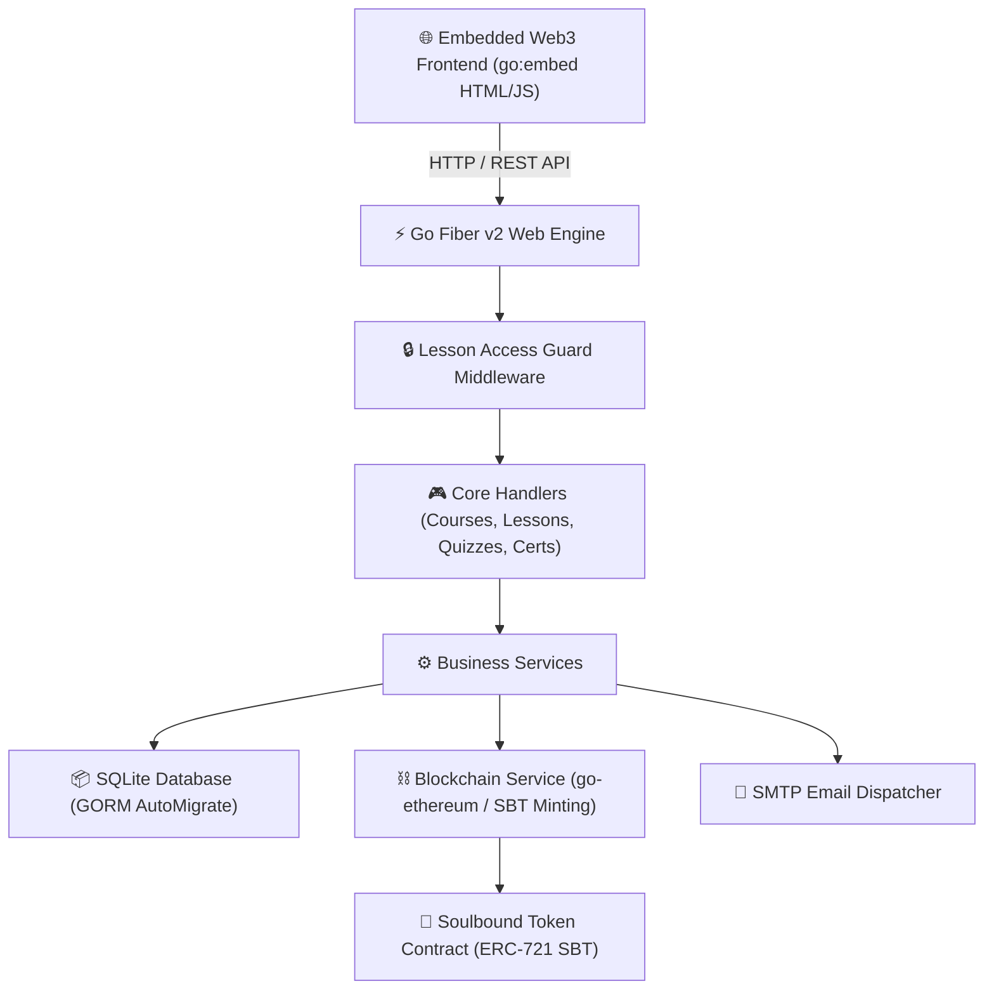

# 🎓 LearnChain: Decentralized E-Learning & Soulbound Token (SBT) dApp

โปรเจกต์ระบบการเรียนการสอนแบบกระจายศูนย์ (Decentralized E-Learning dApp) ที่ถูกออกแบบตามมาตรฐานความปลอดภัยทางสถาปัตยกรรมบล็อกเชน และคอมไพล์เป็นไฟล์ Executable เดียว (**Single Binary `.exe`**) ทำงานได้ทันทีโดยไม่ต้องติดตั้ง Web Server แยก

---

## 🏛️ System Architecture & Tech Stack



- **Backend Framework**: Go 1.22+ พร้อม [Go Fiber v2](https://github.com/gofiber/fiber)
- **Database**: SQLite พร้อม GORM AutoMigrate ทุกโมเดล
- **Frontend Integration**: ใช้ `//go:embed dist/*` ฝังหน้าเว็บทั้งหมดเข้าไปในไบนารี ให้บริการที่พอร์ตเดียว `http://localhost:8888` พร้อมฟังก์ชันเปิดเบราว์เซอร์อัตโนมัติ
- **Smart Contract**: Solidity 0.8.20+ มาตรฐาน ERC-721 Soulbound Token (Non-transferable) ล็อกไม่ให้โอนย้ายเหรียญ

---

## 📂 โครงสร้างไดเรกทอรีโปรเจกต์

```text
DApps/
├── main.go                      # จุดเริ่มต้นโปรแกรม, go:embed dist, Fiber routes, Auto-open browser
├── go.mod                       # รายการ Go Modules & Dependencies
├── .env.example                 # ตัวอย่างการตั้งค่า Environment Variables
├── config/
│   └── config.go               # ตัวโหลด Config จาก .env พร้อม Fallback Defaults
├── database/
│   └── db.go                   # SQLite Connection, GORM AutoMigrate และ Seeding อัตโนมัติ
├── models/
│   └── models.go               # GORM Models ครบทุกตารางตามโจทย์ และ DTO Sanitization
├── middleware/
│   └── access_guard.go         # Lesson Access Guard ตรวจสอบลำดับการเรียน (SortOrder)
├── services/
│   ├── course_service.go       # คำนวณความคืบหน้า, Anti-skip, ตรวจสอบการจบคอร์ส
│   ├── blockchain.go           # บริการ Mint SBT บน EVM และ Mock Simulation
│   └── email.go                # ส่งอีเมลแจ้งเตือนใบประกาศนียบัตรผ่าน SMTP
├── handlers/
│   ├── auth_handler.go         # เชื่อมต่อ Wallet Address และสลับสิทธิ์การใช้งาน
│   ├── course_handler.go       # รายชื่อคอร์สและสถานะการเรียน
│   ├── lesson_handler.go       # บทเรียน และ API รับ Heartbeat วิดีโอ (Anti-skip)
│   ├── quiz_handler.go         # Quiz Grading API ตรวจคำตอบ (ซ่อน IsCorrect)
│   └── certificate_handler.go  # ออกใบรับรอง และสั่ง Mint Soulbound Token
├── contracts/
│   └── SoulboundCertificate.sol# Smart Contract ภาษา Solidity บล็อกการโอนย้ายเหรียญ
└── dist/                       # ส่วนติดต่อผู้ใช้ (Frontend) ที่ถูกฝังลงในไบนารี
    ├── index.html              # หน้าเว็บหลัก Web3 UI
    ├── style.css               # สไตล์โมเดิร์น Dark Theme
    └── app.js                  # ลอจิกฝั่ง Client, ตัวเล่นวิดีโอจำลอง, ตรวจสอบข้อสอบ
```

---

## 🗄️ Database Models (GORM)

1. **User**: `ID`, `WalletAddress` (unique index), `Role` (`learner`, `creator`, `manager`), `Email`, Timestamps
2. **Course**: `ID`, `Title`, `Description`, `CreatorID`, `Lessons` (Relation 1:N)
3. **Lesson**: `ID`, `CourseID`, `Title`, `Description`, `VideoIPFS`, `DocumentIPFS`, `DurationSec`, `SortOrder`, `Quizzes` (Relation 1:N)
4. **Quiz**: `ID`, `LessonID`, `Title`, `Type` (`lesson_pre_test`, `lesson_post_test`), `Questions` (Relation 1:N)
5. **Question**: `ID`, `QuizID`, `QuestionText`, `Options` (Relation 1:N)
6. **Option**: `ID`, `QuestionID`, `OptionText`, `IsCorrect` (bool - *ซ่อนเมื่อส่งให้ Frontend*)
7. **UserLessonProgress**: `ID`, `UserID`, `LessonID`, `PreTestPassed`, `VideoWatched`, `LastWatchedSec`, `PostTestPassed`, `IsCompleted`
8. **QuizAttempt**: `ID`, `UserID`, `QuizID`, `Score`, `TotalScore`, `IsPassed`
9. **Certificate**: `ID`, `UserID`, `CourseID`, `TokenID`, `TransactionHash`, `IssuedAt`

---

## 🛡️ Core Features Implementation

### 1. Lesson Access Guard
- Middleware ตรวจสอบ `SortOrder` ของบทเรียน
- หากเป็นบทเรียนลำดับถัดไป (`SortOrder > 1`) จะตรวจสอบในฐานข้อมูลว่าบทเรียนก่อนหน้า (`SortOrder - 1`) มีสถานะ `IsCompleted == true` แล้วหรือไม่
- หากยังไม่ผ่าน จะปฏิเสธคำขอด้วย `HTTP 403 Forbidden` พร้อมระบุชื่อบทเรียนที่ต้องเรียนให้จบก่อน

### 2. Quiz Grading API & Sensitive Data Sanitization
- Endpoint `GET /api/quizzes/:quizId` จะแปลง Options เป็น `OptionSanitized` เพื่อ**ตัดฟิลด์ `IsCorrect` ออกทั้งหมด** ป้องกันไม่ให้เฉลยรั่วไหลไปสู่ Browser DevTools
- Endpoint `POST /api/quizzes/:quizId/submit` รับเฉพาะคู่ `QuestionID -> OptionID` จากผู้เรียน ตรวจคำตอบเทียบกับฐานข้อมูล และคำนวณคะแนนตามเกณฑ์ 70%
- บันทึกประวัติการสอบลงใน `QuizAttempt` และอัปเดต `PreTestPassed` หรือ `PostTestPassed` ใน `UserLessonProgress` ทันที

### 3. Video Progress & Anti-Skip Guard
- รับค่าตำแหน่งปัจจุบันของวิดีโอ (`current_sec`)
- ตรวจสอบอัตราการเล่น หากผู้ใช้พยายามข้าม (Scrub/Fast-Forward) เกินช่วงเวลาที่อนุญาต (Buffer 15 วินาทีจากจุดล่าสุด) Backend จะตีกลับเป็นข้อผิดพลาด `anti-skip guard: cannot fast-forward past unviewed content`
- สถานะ `VideoWatched` จะเป็น `true` เมื่อรับชมครบ 90% ของระยะเวลาทั้งหมด

### 4. Blockchain SBT Minting
- บันทึกการสำเร็จการศึกษาบน EVM บล็อกเชนผ่าน `go-ethereum`
- รองรับทั้งการเชื่อมต่อ Real Testnet (Sepolia, Polygon Amoy) และโหมด Offline Simulation ซึ่งสร้าง Keccak256 Tx Hash เสมือนจริงให้อัตโนมัติเมื่อยังไม่ได้ระบุ Private Key
- Smart Contract บล็อกคำสั่ง `transferFrom`, `safeTransferFrom`, `approve`, `setApprovalForAll` เพื่อให้เป็น Soulbound Token ผูกติดกับกระเป๋าผู้เรียนตลอดไป

### 5. Email Notification
- เมื่อได้รับใบ Certificate ระบบจะส่งอีเมล HTML แบบ Responsive แจ้งรายละเอียด Token ID, Tx Hash และชื่อหลักสูตรผ่าน SMTP ทันที

---

## 🛠️ วิธีการคอมไพล์เป็นไฟล์ Executable เดียว (.exe) ด้วย Option B (Zero-CGO)

โปรเจกต์ได้รับการกำหนดค่าเริ่มต้นเป็น **Option B (Pure Go SQLite: `github.com/glebarez/sqlite`)** เรียบร้อยแล้ว จึงสามารถคอมไพล์ได้ทันทีบน Windows โดย**ไม่ต้องติดตั้ง GCC/MinGW**:

### วิธีที่ 1: รันผ่าน Script อัตโนมัติ (คลิกเดียวจบ)
- **ดับเบิลคลิกไฟล์ [build.bat](build.bat)** หรือ
- รันใน PowerShell:
  ```powershell
  .\build.ps1
  ```
Script จะทำการตรวจสอบ path ของ Go, อัปเดต dependencies, คอมไพล์เป็น `LearnChain.exe` และรันโปรแกรมขึ้นมาให้ทันที

### วิธีที่ 2: รันคำสั่งด้วยตนเองใน Terminal
```powershell
$env:CGO_ENABLED="0"
go mod tidy
go build -ldflags="-s -w" -o LearnChain.exe .
```

> **คำอธิบาย Flags:**
> - `-ldflags="-s -w"`: ตัดสัญลักษณ์ Debugger (Strip debug information) ออก ช่วยลดขนาดไฟล์ `.exe` ลงประมาณ 30-40% ทำให้ได้ไฟล์ขนาดกะทัดรัด

---

## 🚀 วิธีการรันโปรแกรม

รันไฟล์ `.exe` ผ่าน PowerShell หรือดับเบิลคลิกไฟล์:
```powershell
.\LearnChain.exe
```

### 🔄 การออกเวอร์ชันและการอัปเดต (Release & Auto-Update)
- ออกเวอร์ชันใหม่ขึ้น GitHub Releases อัตโนมัติ:
  ```powershell
  .\release.ps1 v1.0.1
  ```
- เครื่องผู้ใช้สามารถกดปุ่ม **`LearnChain v...`** มุมขวาล่างของหน้าเว็บ เพื่อตรวจสอบเวอร์ชันและกด **อัปเดตและรีสตาร์ท** ได้ทันที (ระบบจะสำรอง `elearning.db` ลง `backups/` อัตโนมัติก่อนอัปเกรด)

เมื่อโปรแกรมเริ่มทำงาน:
1. ระบบจะเชื่อมต่อและสร้างฐานข้อมูล SQLite (`elearning.db`) อัตโนมัติ
2. ดำเนินการ AutoMigrate และใส่ข้อมูลตัวอย่าง (Seed Course, Lessons 1-2, Quizzes)
3. เปิดเว็บเบราว์เซอร์อัตโนมัติไปที่ `http://localhost:8888`
4. คุณสามารถทดสอบลำดับการเรียน:
   - ทดสอบทำ Pre-Test บทเรียนที่ 1
   - เล่นวิดีโอ (ทดสอบเลื่อนข้ามเพื่อดูระบบ Anti-Skip ปฏิเสธ)
   - ทำ Post-Test บทเรียนที่ 1 เพื่อปลดล็อกบทเรียนที่ 2
   - ทำบทเรียนที่ 2 จนจบ แล้วกดปุ่ม **"✨ Mint Soulbound Certificate (SBT)"** เพื่อรับใบรับรองบนบล็อกเชน!
